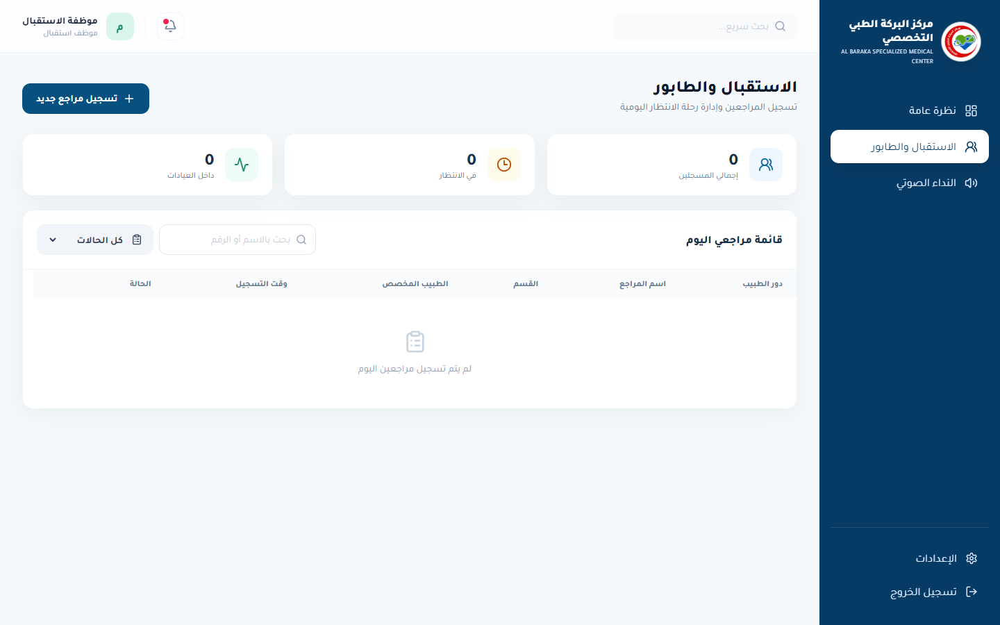
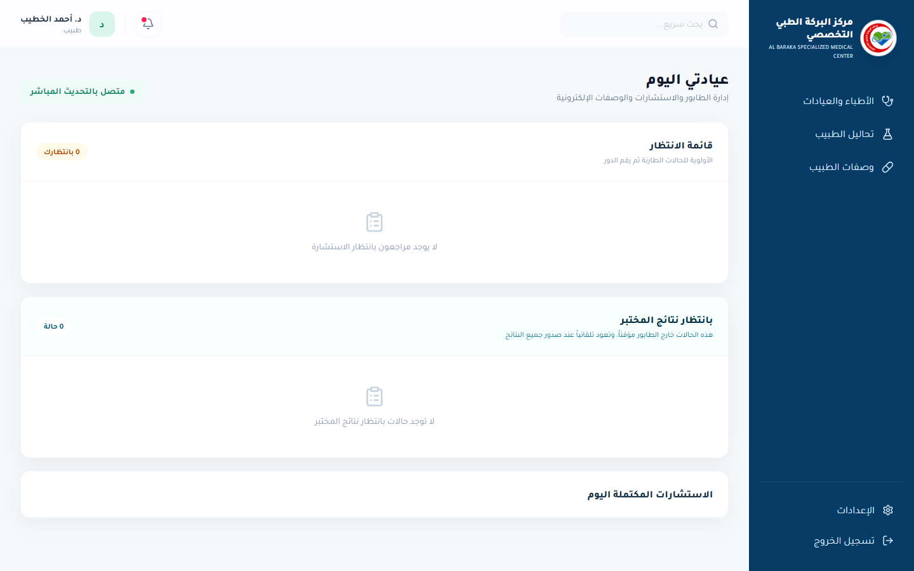
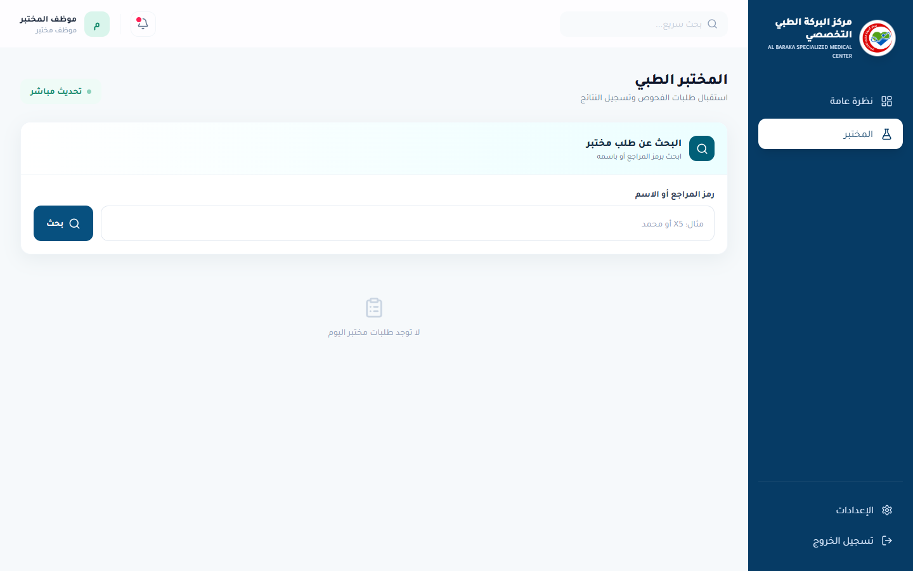
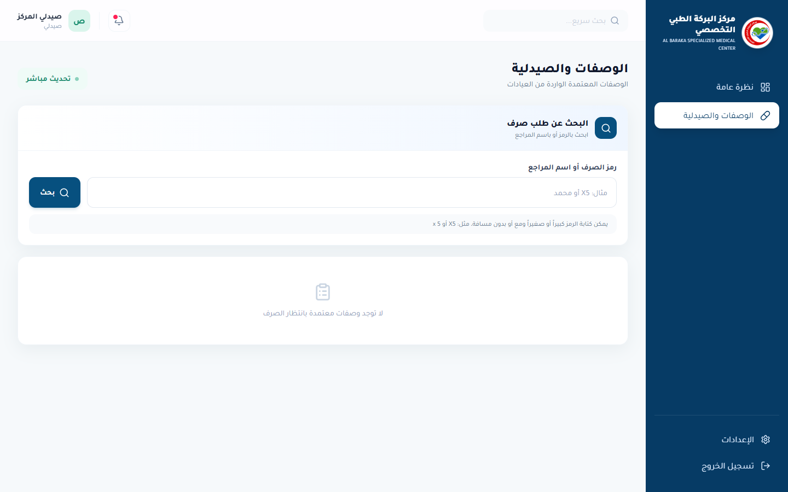

<h1 align="center">Mohammed Khaled</h1>
<h3 align="center">Full-Stack & Flutter Developer</h3>

  I turn real operational workflows into secure, responsive and testable web and mobile products.

  
  

---

## About me

I build complete products across frontend, backend, data and cloud delivery. My work focuses on maintainable architecture, Arabic-first RTL experiences, granular permissions, automated testing and reliable operational workflows.

- Based in Gaza and open to remote or relocation opportunities
- Comfortable owning a product from requirements and database design through testing and deployment
- Interested in full-stack, backend, frontend and Flutter roles

## Technology stack

  
  
  
  
  
  
  
  
  
  
  

## Selected work

### Secure TaskFlow — Public Engineering Sample

A compact, reviewable Arabic RTL full-stack sample created specifically to demonstrate code quality without exposing proprietary project source.

- Public React + TypeScript and FastAPI code
- Server-enforced authorization with JWT and Argon2
- PostgreSQL-backed GitHub Actions quality gate
- Frontend and API tests, Docker and a documented technical case study

### Al Baraka Medical Center Management System

An Arabic-first healthcare operations platform covering the outpatient journey from reception and doctor queues through consultations, laboratory results, prescriptions, pharmacy dispensing and operational day closing.

- Five responsive, role-specific RTL workspaces
- React, TypeScript, FastAPI and PostgreSQL architecture
- Dental EMR, laboratory attachments and centralized voice calling
- Granular RBAC, MFA, audit trails and encrypted backups
- 44 backend tests, 3 frontend tests and 19 browser end-to-end scenarios

> Synthetic demonstration data only · Source private

<b>Product interface gallery — reception, doctor, laboratory and pharmacy</b>

 

  
  

  
  

### Mustardat — AI Lost & Found

A privacy-focused lost-and-found platform that combines FastAPI with CLIP, YOLO and multi-signal similarity matching to connect reports efficiently.

- Computer-vision-assisted image matching
- Privacy-aware reporting workflow
- Responsive browser experience backed by a Python API

> Source private

### Najdah Mobile App

A bilingual Flutter coordination application connecting requesters and donors through role-based flows, location services, chat, notifications, OTP verification and delivery tracking.

- Mobile-first Flutter experience
- Real-time communication and location-aware workflows
- Private case study and source walkthrough available to recruiters on request

## Verified engineering evidence

| Project | Reproducible evidence | Verified result |
| --- | --- | --- |
| Secure TaskFlow | Public authorization PR + PostgreSQL CI | [PR #1](https://github.com/mohhdkh/secure-taskflow/pull/1): 10 backend/API tests, 1 frontend test and production build passed; CI jobs completed in 27s and 16s |
| Al Baraka Medical Center | Private unit, integration and browser workflow suites | 44 backend tests, 3 frontend tests and 19 browser scenarios passed; production build passed on 26 October 2026 |

Al Baraka's tested browser scenarios cover reception registration, doctor queue and consultation, laboratory referral and result return, grouped prescriptions, pharmacy dispensing, dental EMR, centralized voice calls, responsive role workspaces and operational day closing. Source and detailed reports remain private to protect product IP.

Performance numbers are published only when measured in a named environment; test duration is not presented as production API latency.

## Engineering approach

| Area | What I prioritize |
| --- | --- |
| Product | Real workflows, clear roles and responsive Arabic/English UX |
| Backend | Explicit domain rules, secure APIs and relational data integrity |
| Quality | Unit, integration, concurrency and browser end-to-end testing |
| Security | Least privilege, MFA, auditability and protected secrets |
| Delivery | CI quality gates, reproducible builds, backups and recovery planning |

## Currently focused on

- Designing maintainable systems around real operational workflows
- Improving PostgreSQL concurrency, browser automation and cloud resilience
- Building accessible Arabic and English product experiences

## Contact

I am open to full-stack, backend, frontend and Flutter opportunities.

- [LinkedIn — Mohammed Khattab](https://www.linkedin.com/in/mohammed-khattab1/)
- [GitHub — @mohhdkh](https://github.com/mohhdkh)

Project source code is private to protect product IP. Live demonstrations and technical walkthroughs are available for legitimate recruitment conversations.